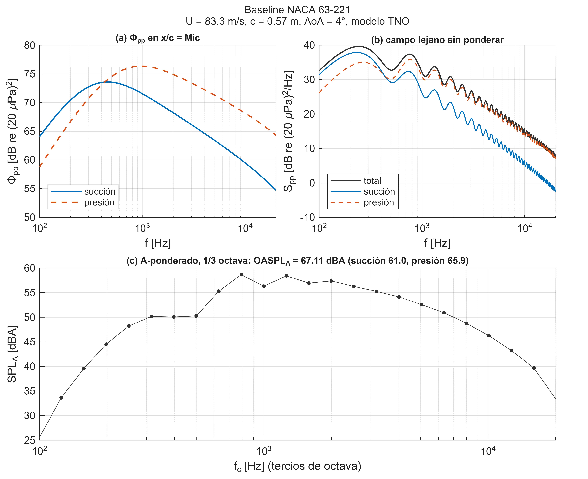
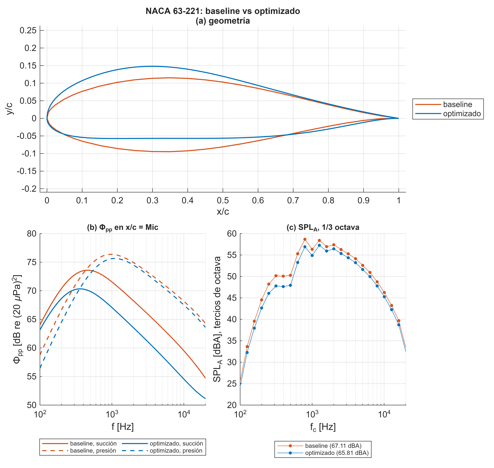
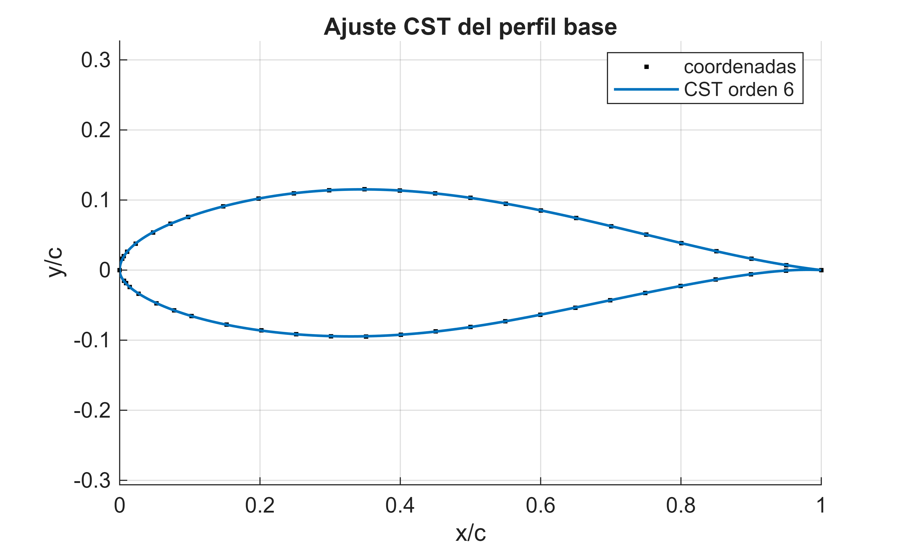
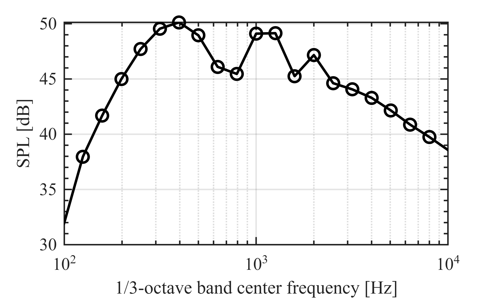
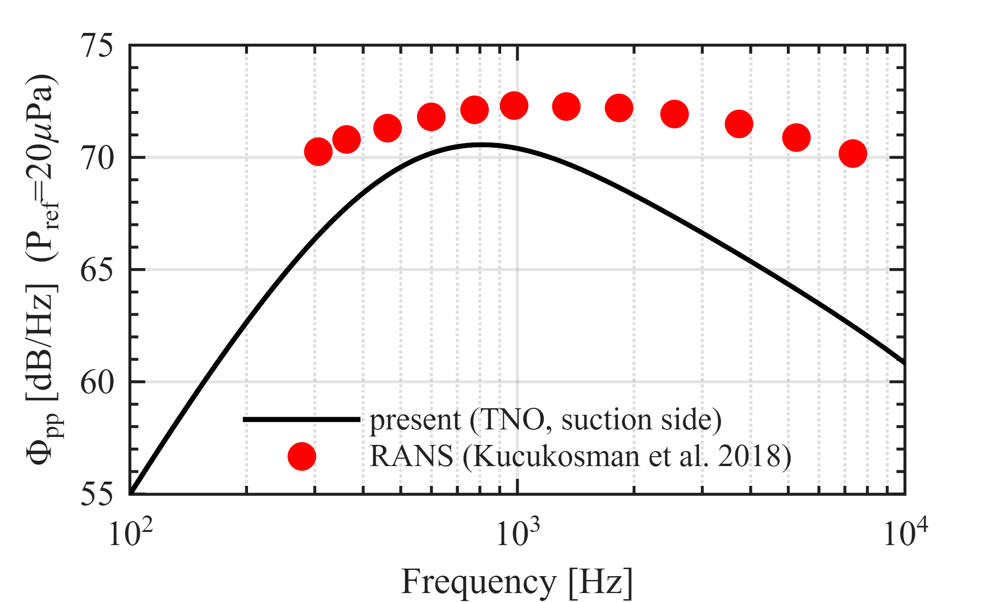
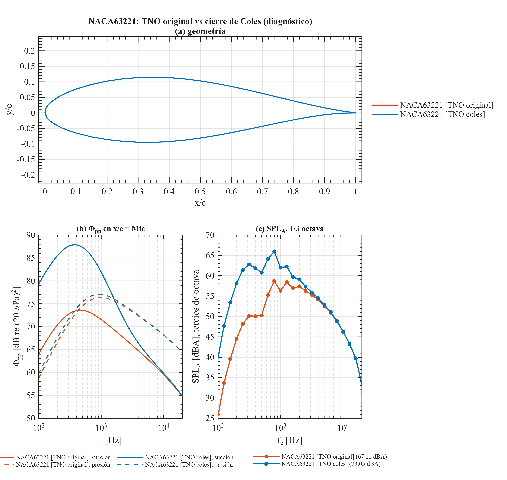
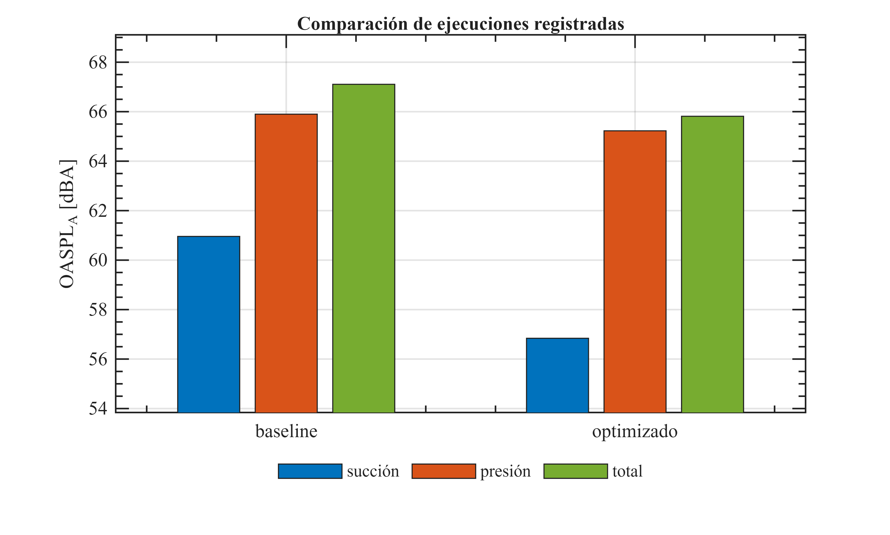
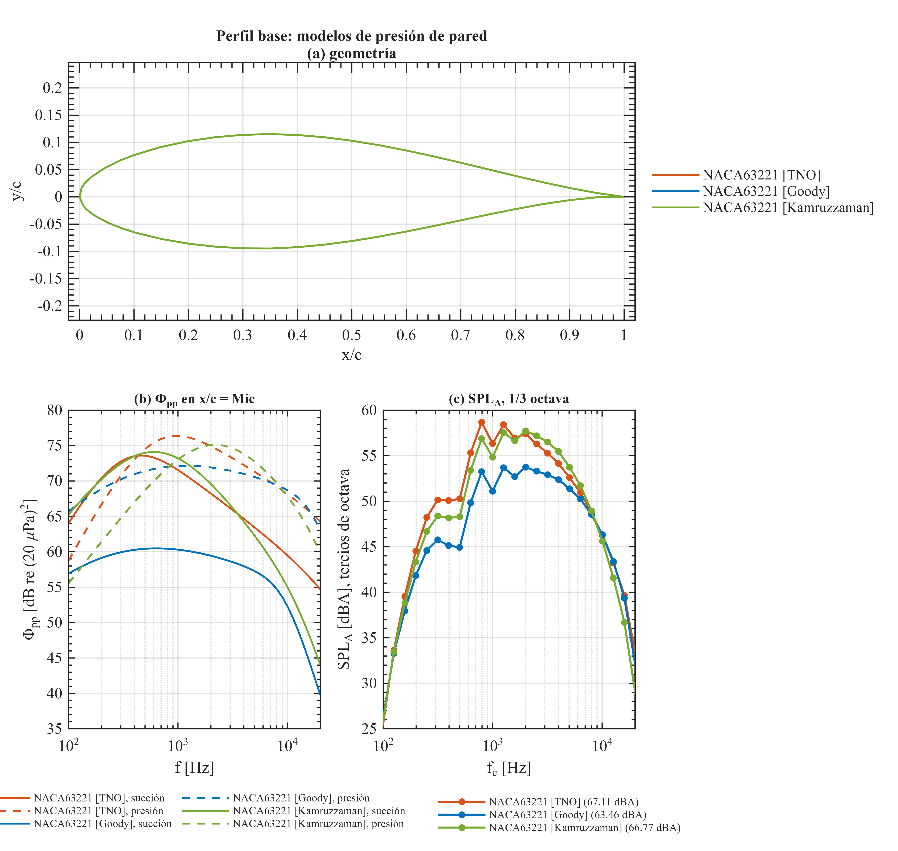
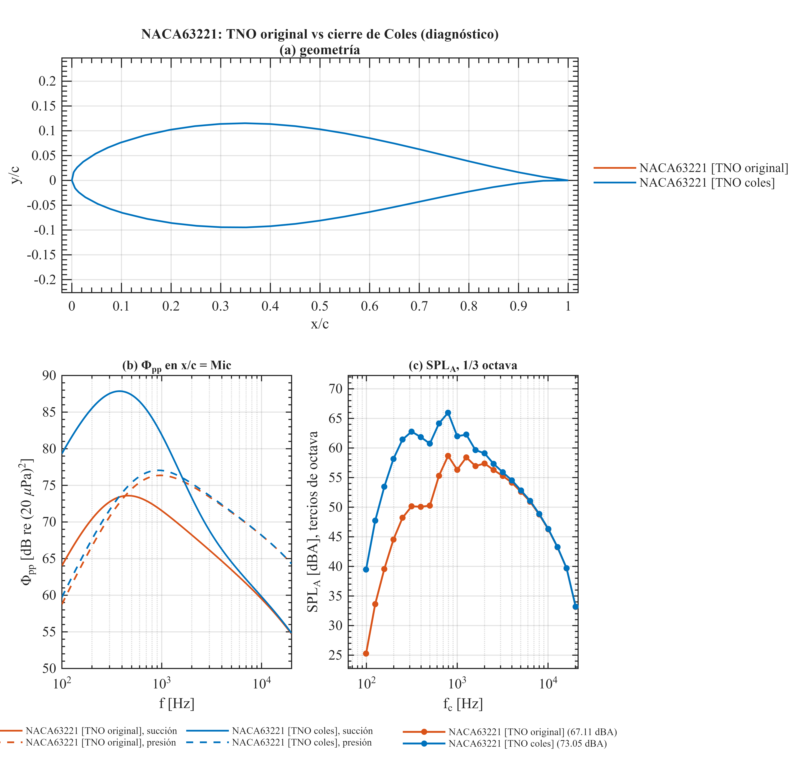

# Optimización de la silueta de un perfil para reducir el ruido de borde de fuga

**Proyecto Opti\_Param\_ruido** — cuaderno de investigación computacional. Este Live Script es el centro de control del proyecto: inicializa las rutas, fija los parámetros, ejecuta cada módulo de forma independiente, muestra los resultados y los exporta. Los algoritmos están en funciones de `src/`; aquí solo se coordinan.


**Descripción general.** La cadena de predicción toma un perfil aerodinámico (archivo de coordenadas), calcula su capa límite con XFOIL, construye el espectro de presión de pared en el borde de fuga $\Phi_{pp} (\omega )$ con un modelo semi\-empírico (TNO–Blake por defecto; también Goody, Kamruzzaman y Amiet) y lo propaga al campo lejano con la teoría de Amiet / Roger–Moreau (incluida la retrodispersión). El optimizador parametriza la silueta con funciones CST (Kulfan, 14 coeficientes) y busca la geometría que minimiza el nivel global ponderado A, ${\mathrm{OASPL}}_A$, con restricciones aerodinámicas ( $c_l /c_d \ge$ baseline), geométricas (espesor) y de adherencia de la capa límite.


**Objetivos computacionales**

-  Predecir el ruido de borde de fuga de un perfil en un punto de operación dado. 
-  Comparar baseline y perfil optimizado (espectros, niveles por lado, capa límite). 
-  Validar la cadena frente al caso de referencia NACA 0012. 
-  Cuantificar la sensibilidad al modelo de presión de pared. 
-  Ejecutar (bajo demanda) la optimización y los estudios del manuscrito. 
-  Registrar, comparar y exportar los resultados de cada ejecución. 

**Flujo de trabajo**

 $$ \textrm{coeficientes}\;\textrm{CST}\;\to \;\textrm{coordenadas}\;\to \;\textrm{XFOIL}\;(\delta^* ,\theta ,C_f ,U_e ,\partial C_p /\partial x)\;\to \;\Phi_{pp} (\omega )\;\to \;S_{pp} (\omega )\;\to \;{\mathrm{OASPL}}_A $$ 

El espectro en el observador y el nivel global son

 $$ S_{pp} (\omega )={\left(\frac{\omega \,z\,b}{2\pi c_0 S_0^2 }\right)}^2 2\pi L\,|I(\omega )|^2 \,\Pi_0 (\omega ),~~~~\Pi_0 (\omega )=\frac{1}{\pi }\,\Phi_{pp} (\omega )\,l_y (\omega ) $$ 

 $$ {\mathrm{OASPL}}_A =10\log_{10} \left(\frac{1}{p_{ref}^2 }\int S_{pp} (f)\,10^{A(f)/10} \,df\right),~~~~\mathrm{OASPL}=10\log_{10} \left(10^{L_s /10} +10^{L_p /10} \right) $$ 

donde $L_s$ y $L_p$ son las contribuciones de succión y presión (suma incoherente de los dos lados).


**Módulos del proyecto** (carpeta `src/`)

-  `acoustics/` — números de onda, integrales de radiación (Amiet + retrodispersión), campo lejano, tercios de octava. 
-  `wall_pressure/` — espectro de presión de pared: TNO (perfil de velocidad, fluctuaciones, espectro de von Kármán), Goody, Kamruzzaman, Amiet. 
-  `boundary_layer/` — envoltorio de XFOIL y parámetros de capa límite. 
-  `geometry/` — CST, Hicks–Henne, PARSEC, lectura/escritura de perfiles, espesor y curvatura. 
-  `evaluation/` — `evaluate_airfoil` (perfil → OASPL), `predecir_ruido` (resultado completo), evaluador memoizado, definición del problema. 
-  `optimization/` — objetivos, restricciones y corridas (pattern search, multiobjetivo). 
-  `studies/` — estudios del manuscrito (robusto, sensibilidad, comparación de algoritmos, off\-design, ...). 
-  `postprocessing/` — tablas, validación NACA 0012, polares 360°, registro y exportación. 
-  `visualization/` — figuras de publicación y estilo. 
-  `utilities/` — rutas, directorio de trabajo de XFOIL, búsqueda de archivos. 

Las secciones de este documento se ejecutan con **Run Section** (Ctrl+Enter). Ejecute primero la **Inicialización** y los **Parámetros generales**; después cualquier módulo de forma independiente. Las dependencias entre secciones se indican en cada una.

# 1. Inicialización

Localiza la raíz del proyecto a partir de este archivo (no depende del directorio desde el que se abrió MATLAB), añade `src/`, `config/` y `tests/` al path, crea las carpetas de `results/` si faltan y copia `xfoil.exe` a su carpeta de trabajo. **Ejecutar una vez por sesión.**

```matlab
clearvars; close all; clc;
try
    raiz = fileparts(matlab.desktop.editor.getActiveFilename);
catch
    raiz = '';
end
if isempty(raiz) || ~exist(fullfile(raiz, 'proyecto_init.m'), 'file')
    raiz = fileparts(which('proyecto_init'));
end
if isempty(raiz), raiz = pwd; end
addpath(raiz);
rutas = proyecto_init();
fprintf('Proyecto: %s\nXFOIL   : %s\nFiguras : %s\n', rutas.raiz, rutas.xfoil_work, rutas.figuras);
```

```matlabTextOutput
Proyecto: C:\Users\josea\Desktop\Opti_Param_ruidoio\Proyecto_RuidoPerfil
XFOIL   : C:\Users\josea\Desktop\Opti_Param_ruidoio\Proyecto_RuidoPerfil\results\simulations\xfoil_work
Figuras : C:\Users\josea\Desktop\Opti_Param_ruidoio\Proyecto_RuidoPerfil\results\figures
```

```matlab
registro = [];          % registro de resultados de la sesión (Sección 4)
figuras_sesion = [];    % figuras que se exportarán al final
```
# 2. Parámetros generales

Todos los parámetros viven en la estructura `cfg` (ver `config/configuracion_general.m`). Edite los valores aquí y vuelva a ejecutar la sección; `actualizar_caso` recalcula las magnitudes derivadas (Mach, Reynolds, semicuerda). Los valores por defecto son los del manuscrito.

```matlab
cfg = configuracion_general();

% --- caso de operación (sección de pala) ---------------------------------
cfg.caso.chord = 0.57;      % cuerda [m]
cfg.caso.span  = 1;         % envergadura del tramo [m]
cfg.caso.U     = 83.31;     % velocidad relativa [m/s]
cfg.caso.AoA   = 4;         % ángulo de ataque [deg]
cfg.caso.xtr_s = 0.05;      % transición forzada, succión (x/c; 1 = natural)
cfg.caso.xtr_p = 0.05;      % transición forzada, presión
cfg.caso.Mic   = 0.99;      % x/c donde se evalúa Phi_pp (fuente)
% --- observador -----------------------------------------------------------
cfg.caso.x = 0; cfg.caso.y = 0; cfg.caso.z = 1;   % [m], 1 m sobre el borde de fuga
% --- modelo de presión de pared --------------------------------------------
cfg.caso.model      = 'TNO';        % 'TNO' | 'Goody' | 'Kamruzzaman' | 'Amiet'
cfg.caso.tno_perfil = 'original';   % 'original' (reproduce el paper) | 'coles' (diagnóstico)
% --- perfiles del caso principal ------------------------------------------
cfg.perfiles.base       = 'NACA63221.txt';
cfg.perfiles.base_cst   = 'cst_baseline_NACA63221.dat';
cfg.perfiles.optimizado = 'optimized_NACA63221_hardcon.dat';
% --- exportación ------------------------------------------------------------
cfg.exportar.dpi = 300;

cfg = actualizar_caso(cfg);
T_param = table(cfg.caso.chord, cfg.caso.U, cfg.caso.AoA, cfg.caso.Re, cfg.caso.M, cfg.caso.xtr_s, ...
    string(cfg.caso.model), string(cfg.caso.tno_perfil), ...
    'VariableNames', {'cuerda_m','U_m_s','AoA_deg','Re','Mach','x_tr','modelo_WPS','perfil_TNO'});
disp(T_param)
```

```matlabTextOutput
    cuerda_m    U_m_s    AoA_deg        Re         Mach      x_tr    modelo_WPS    perfil_TNO
    ________    _____    _______    __________    _______    ____    __________    __________

      0.57      83.31       4       3.1658e+06    0.24192    0.05      "TNO"       "original"
```

# 3. Módulos

Cada módulo indica su coste (número de llamadas a XFOIL, ~5–10 s cada una) y sus dependencias. Los módulos costosos están protegidos por un interruptor `ejecutar_* = false` para que esta sección no lance por accidente una optimización de horas.

# 3.1 Predicción de ruido de un perfil

**Qué hace:** corre la cadena completa (XFOIL → capa límite → $\Phi_{pp}$ → Amiet → campo lejano) para el perfil base y devuelve el espectro, los niveles globales, la contribución de cada lado y los parámetros de capa límite. **Entradas:** `cfg.perfiles.base`, `cfg.caso`, `cfg.fluido`. **Coste:** 1 XFOIL. **Depende de:** secciones 1 y 2.

```matlab
res_base = predecir_ruido(cfg.perfiles.base, cfg, 'baseline');
```

```matlabTextOutput
XFoil Converged
```

```matlab
fig_pred = graficar_prediccion(res_base, struct('titulo', 'Baseline NACA 63-221'));
```



```matlab
disp(tabla_resumen(res_base))
```

```matlabTextOutput
      etiqueta      OASPL_A    OASPL_lin    OASPL_A_succion    OASPL_A_presion      Cl        Cd       Cl_Cd       Cm       modelo     AoA      U      chord
    ____________    _______    _________    _______________    _______________    ______    _______    ______    _______    _______    ___    _____    _____

    {'baseline'}    67.107      68.363          60.958             65.899         0.6275    0.01163    53.955    -0.0375    {'TNO'}     4     83.31    0.57 
```

```matlab
disp(res_base.capa_limite)
```

```matlabTextOutput
       lado        dstar_c     theta_c       H          Cf       Ue_Uinf    Phi_pk_dB
    ___________    ________    ________    ______    ________    _______    _________

    {'succion'}    0.014861    0.006569    2.2623    0.000332    0.86878     73.594  
    {'presion'}    0.004084    0.002815    1.4508    0.001738    0.86727     76.363  
```

```matlab
registro = registrar_resultado(registro, res_base, 'baseline');
figuras_sesion = [figuras_sesion fig_pred];
```

**Interpretación.** El pico del espectro de presión de pared de succión está a menor frecuencia (capa límite más gruesa) y el de presión a mayor frecuencia y nivel (capa más delgada y con mayor fricción). Escriba aquí sus observaciones sobre este caso.

# 3.2 Baseline frente a perfil optimizado

**Qué hace:** evalúa el perfil optimizado publicado (`cfg.perfiles.optimizado`) y lo compara con el baseline: geometría, $\Phi_{pp}$ por lado y espectro A ponderado en tercios de octava. **Coste:** 1 XFOIL. **Depende de:** 3.1.

```matlab
res_opt = predecir_ruido(cfg.perfiles.optimizado, cfg, 'optimizado');
```

```matlabTextOutput
XFoil Converged
```

```matlab
fig_comp = graficar_comparacion({res_base, res_opt}, struct('titulo', 'NACA 63-221: baseline vs optimizado'));
```



```matlab
T_comp = tabla_resumen({res_base, res_opt});
disp(T_comp)
```

```matlabTextOutput
       etiqueta       OASPL_A    OASPL_lin    OASPL_A_succion    OASPL_A_presion      Cl        Cd       Cl_Cd       Cm       modelo     AoA      U      chord
    ______________    _______    _________    _______________    _______________    ______    _______    ______    _______    _______    ___    _____    _____

    {'baseline'  }    67.107      68.363          60.958             65.899         0.6275    0.01163    53.955    -0.0375    {'TNO'}     4     83.31    0.57 
    {'optimizado'}    65.815      66.811          56.841             65.227         0.7128    0.01301    54.789    -0.0127    {'TNO'}     4     83.31    0.57 
```

```matlab
fprintf('Reducción de OASPL_A: %.2f dBA  (Cl/Cd %.1f -> %.1f)\n', ...
        res_base.OASPL_A - res_opt.OASPL_A, res_base.clcd, res_opt.clcd);
```

```matlabTextOutput
Reducción de OASPL_A: 1.29 dBA  (Cl/Cd 54.0 -> 54.8)
```

```matlab
registro = registrar_resultado(registro, res_opt, 'optimizado');
figuras_sesion = [figuras_sesion fig_comp];
```

**Interpretación.** Anote aquí qué cambia en la geometría, en la capa límite y en qué banda de frecuencias se obtiene la reducción.

# 3.3 Tabla de capa límite en x/c = 0.99

**Qué hace:** reúne $\delta^* /c$, $\theta /c$, $H$, $C_f$, $U_e /U_{\infty }$ y el pico de $\Phi_{pp}$ de ambos lados para los perfiles ya evaluados (equivale a la tabla de capa límite del manuscrito). **Coste:** ninguno. **Depende de:** 3.2.

```matlab
T_bl = tabla_capa_limite({res_base, res_opt});
disp(T_bl)
```

```matlabTextOutput
         caso            lado        dstar_c     theta_c       H          Cf       Ue_Uinf    Phi_pk_dB
    ______________    ___________    ________    ________    ______    ________    _______    _________

    {'baseline'  }    {'succion'}    0.014861    0.006569    2.2623    0.000332    0.86878     73.594  
    {'baseline'  }    {'presion'}    0.004084    0.002815    1.4508    0.001738    0.86727     76.363  
    {'optimizado'}    {'succion'}    0.021329     0.00814    2.6203     0.00015    0.86059      70.33  
    {'optimizado'}    {'presion'}    0.004194     0.00264    1.5886    0.001399    0.87161     75.645  
```

# 3.4 Parametrización de la silueta (CST)

**Qué hace:** ajusta por mínimos cuadrados los 14 coeficientes CST (orden 6 por superficie) al perfil base y muestra el error de reconstrucción. Estos coeficientes son las variables de diseño del optimizador. **Coste:** ninguno.

 $$ y(\psi )=\psi^{N_1 } (1-\psi )^{N_2 } \sum_{i=0}^n A_i \,\binom{n}{i}\psi^i (1-\psi )^{n-i} +\psi \,y_{TE} $$ 
```matlab
af = load_airfoil(cfg.perfiles.base);
p_cst = cst_fit(af, 6);
[xc, yc, xu, yu, xl, yl] = cst_to_coords(p_cst.Au, p_cst.Al, p_cst.yte_u, p_cst.yte_l, 200, p_cst.N1, p_cst.N2);
err_u = interp1(xu, yu, af.xu, 'pchip') - af.yu;  err_l = interp1(xl, yl, af.xl, 'pchip') - af.yl;
fprintf('Error de reconstrucción CST(6): rms = %.2e c, máx = %.2e c\n', sqrt(mean([err_u; err_l].^2)), max(abs([err_u; err_l])));
```

```matlabTextOutput
Error de reconstrucción CST(6): rms = 2.24e-04 c, máx = 8.52e-04 c
```

```matlab
fig_cst = figure('Color','w'); hold on; grid on; axis equal;
plot(af.x, af.y, 'k.', 'MarkerSize', 6, 'DisplayName', 'coordenadas');
plot(xc, yc, '-', 'Color', [0 0.447 0.741], 'LineWidth', 1.2, 'DisplayName', 'CST orden 6');
xlabel('x/c'); ylabel('y/c'); legend('Location', 'best'); title('Ajuste CST del perfil base');
```



```matlab
T_cst = table((0:6)', p_cst.Au(:), p_cst.Al(:), 'VariableNames', {'i', 'A_superior', 'A_inferior'});
disp(T_cst)
```

```matlabTextOutput
    i    A_superior    A_inferior
    _    __________    __________

    0     0.25517       -0.19841 
    1      0.2666       -0.27532 
    2     0.34918       -0.19816 
    3     0.29243       -0.36212 
    4     0.28756      -0.093961 
    5     0.21504       -0.21467 
    6      0.1188       0.055036 
```


Para la comparación completa CST / PARSEC / Hicks–Henne del manuscrito, ejecute `compare_parameterizations(cfg.perfiles.base)` (sin XFOIL; guarda `parameterization_comparison.png` en `results/figures/`).

```matlab
ejecutar_comparacion_parametrizaciones = false;
if ejecutar_comparacion_parametrizaciones
    compare_parameterizations(cfg.perfiles.base);
end
```
# 3.5 Validación frente al caso NACA 0012

**Qué hace:** corre el caso de referencia (NACA 0012, $c=0.4$ m, $U=56$ m/s, $Re=1.5\times 10^6$, AoA = 0°, transición en 0.06) y compara el espectro de presión de pared con las curvas de referencia de `data/reference/Ref_fig_SPM` (Kucukosman et al. 2018). **Coste:** 2 XFOIL. Las figuras se guardan en `results/figures/` (`fig_validation_farfield.png`, `fig_validation_wps.png`). **Nota:** las curvas `*``_G``oody.tsv` son las del modelo de Goody de esa figura, no las medidas (ver `documentation/HALLAZGO_TNO.md`).

```matlab
ejecutar_validacion = true;
if ejecutar_validacion
    dir_actual = pwd;
    validate_naca0012();          % usa el workspace heredado y restaura el directorio
    cd(dir_actual);
end
```

```matlabTextOutput
XFoil Converged

=== NACA0012 validation (AoA=0, U=56 m/s, Re=1.49e+06, M=0.163) ===
  OASPL 1000-6300 Hz : 54.97 dB   (present work)
  reference          : 68.87 (Kou), 68.81 (RANS), 67.67-68.83 (exp)
  --- diagnostics ---
  OASPL full band    : 59.25 dB  (un-weighted, 100-20000 Hz)
  full-band OASPL(A) : 57.72 dBA | Cl=0.629 Cd=0.01123
  spectral peak at   : 334 Hz | energy below 1 kHz = 59%
```



```matlabTextOutput
  saved C:\Users\josea\Desktop\Opti_Param_ruidoio\Proyecto_RuidoPerfil\results\figures\fig_validation_farfield.png  (9.0 x 5.4 cm, 600 dpi)
XFoil Converged
```



```matlabTextOutput
  saved C:\Users\josea\Desktop\Opti_Param_ruidoio\Proyecto_RuidoPerfil\results\figures\fig_validation_wps.png  (9.0 x 5.4 cm, 600 dpi)
  NOTE: if the wall-pressure curve is offset by a constant, it is
  the per-Hz vs per-rad convention (Phi(f)=2*pi*Phi(omega)); adjust.
```

# 3.6 Sensibilidad al modelo de presión de pared

**Qué hace:** evalúa el perfil base con TNO, Goody y Kamruzzaman sobre la misma capa límite de XFOIL y compara espectros y niveles. **Coste:** 3 XFOIL. **Advertencia:** el Kamruzzaman del código original lleva $u_{\tau }$ fijo (`Kamruzzaman.m`, línea 2); ver `documentation/HALLAZGO_TNO.md`.

```matlab
modelos_wps = {'TNO', 'Goody', 'Kamruzzaman'};
[T_wps, res_wps] = comparar_modelos_wps(cfg.perfiles.base, cfg, modelos_wps);
```

```matlabTextOutput
XFoil Converged
XFoil Converged
XFoil Converged
```

```matlab
disp(T_wps(:, {'etiqueta', 'OASPL_A', 'OASPL_A_succion', 'OASPL_A_presion', 'modelo'}))
```

```matlabTextOutput
             etiqueta              OASPL_A    OASPL_A_succion    OASPL_A_presion        modelo     
    ___________________________    _______    _______________    _______________    _______________

    {'NACA63221 [TNO]'        }    67.107         60.958             65.899         {'TNO'        }
    {'NACA63221 [Goody]'      }    63.456         50.832             63.212         {'Goody'      }
    {'NACA63221 [Kamruzzaman]'}    66.769         61.902             65.055         {'Kamruzzaman'}
```

```matlab
fig_wps = graficar_comparacion(res_wps, struct('titulo', 'Perfil base: modelos de presión de pared'));
```


```matlab
figuras_sesion = [figuras_sesion fig_wps];
```
# 3.7 Diagnóstico del perfil de velocidad del modelo TNO

**Qué hace:** compara, para el perfil base, el $\Phi_{pp}$ de TNO con el perfil de velocidad original del código y con el cierre de Coles ( $\Pi$ tal que $U(\delta )=U_e$ ). En el código original el parámetro de Clauser se calcula sin la presión dinámica, por lo que $\Pi \approx 0.48$ siempre y el perfil de succión no alcanza $U_e$ cuando $C_f$ es bajo. **Coste:** 2 XFOIL. **Estado:** el modo `'coles'` es una opción de diagnóstico NO validada; ningún resultado publicado lo usa (`cfg.caso.tno_perfil = 'original'` por defecto). Detalles en `documentation/HALLAZGO_TNO.md`.

```matlab
ejecutar_diagnostico_tno = true;
if ejecutar_diagnostico_tno
    [T_tno, res_tno, fig_tno] = diagnostico_perfil_tno(cfg.perfiles.base, cfg);
    disp(T_tno(:, {'etiqueta', 'OASPL_A', 'OASPL_A_succion', 'OASPL_A_presion'}))
    figuras_sesion = [figuras_sesion fig_tno];
end
```

```matlabTextOutput
XFoil Converged
XFoil Converged
```



```matlabTextOutput
              etiqueta              OASPL_A    OASPL_A_succion    OASPL_A_presion
    ____________________________    _______    _______________    _______________

    {'NACA63221 [TNO original]'}    67.107         60.958             65.899     
    {'NACA63221 [TNO coles]'   }    73.049             72             66.365     
```

# 3.8 Análisis de sensibilidad de las variables de diseño

**Qué hace:** barrido uno\-a\-uno de los 14 coeficientes CST dentro de sus cotas y su efecto sobre ${\mathrm{OASPL}}_A$ y $c_l /c_d$ (tornado, curvas y siluetas). **Coste:** `nlev` × 14 XFOIL (≈100 evaluaciones con 7 niveles). Guarda `sensitivity_data.mat` en el workspace heredado y las figuras en `results/figures/`.

```matlab
ejecutar_sensibilidad = false;
niveles_sensibilidad = 7;
if ejecutar_sensibilidad
    dir_actual = pwd;
    sensitivity_analysis(niveles_sensibilidad, cfg.perfiles.base);
    cd(dir_actual);
end
```
# 3.9 Optimización de la silueta

**Qué hace:** minimiza ${\mathrm{OASPL}}_A$ sobre los coeficientes CST con `patternsearch`, restricción dura $c_l /c_d \ge$ baseline, cotas de espesor y guardas de adherencia de la capa límite de succión ( $H\le 2.7$, $C_f \ge 1.5\times 10^{-4}$ ). **Coste:** `presupuesto` XFOIL (el manuscrito usa 400–2000). Cada corrida escribe en su propia carpeta `results/simulations/<fecha>_opt_<caso>/` (geometría, `.mat` con el historial, figuras) y **no** sobrescribe el óptimo publicado de `data/optimized/`.

 $$ \min_{\mathbf{a}} ~{\mathrm{OASPL}}_A (\mathbf{a})~~\textrm{s.a.}~~c_l /c_d \ge (c_l /c_d )_0 ,~~0.5\,T_0 \le t_{\max } \le T_0 ,~~H_s \le 2.7,~~C_{f,s} \ge 1.5\times 10^{-4} $$ 
```matlab
ejecutar_optimizacion = false;
presupuesto = 60;                       % evaluaciones de XFOIL
if ejecutar_optimizacion
    dv_opt = run_optimization(presupuesto, cfg.perfiles.base);
end
```

Otras corridas disponibles (mismo patrón de salida):

-  `run_multiobjective(popsize, gens, base)` — frente de Pareto ruido / eficiencia (`gamultiobj`). 
-  `compare_algorithms('budget', n)` — GA, PSO, pattern search, surrogate, SQP sobre el mismo problema. 
-  `definitivo_robusto` / `opt_robusto_63218` — optimización robusta multi\-modelo (min–max TNO/Goody/Kamruzzaman). 

Para el caso NACA 63\-218 use `cfg.perfiles.base = 'NACA63218.txt'`.

# 3.10 Estudios del manuscrito y figuras de publicación (heredados)

Las funciones de `src/studies/` y `src/visualization/` reproducen los estudios y figuras del artículo (sensibilidad al modelo, off\-design, auditoría, comparación de algoritmos, polares 360°, ...). Se ejecutan tal como se ejecutaron para el manuscrito; usan el workspace heredado (`results/simulations/legacy_workspace/`, donde están copiados los datos) y guardan las figuras en `results/figures/`. Ejemplos:

-  `plot_mechanism('NACA63221.txt')` — geometría y mecanismo aero\-acústico (2 XFOIL). 
-  `fig_mechanism_aero_v2('NACA63221.txt')` — figura revisada con ambos lados en los mismos ejes (2 XFOIL). 
-  `boundary_layer_table('NACA63221.txt')` — tabla de capa límite en LaTeX (2 XFOIL). 
-  `silhouette_variation('NACA63221.txt')` — modos CST y envolvente de diseño (sin XFOIL). 
-  `review_studies` — sensibilidad al modelo, Cf/H a lo largo de la cuerda y off\-design (≈60 XFOIL). 
-  `polar_360` — polares ±180° para simulación de pala (XFOIL + Viterna). 

Estas funciones cambian el directorio de trabajo; use `cd(rutas.raiz)` al terminar si lo necesita.

```matlab
ejecutar_figuras_mecanismo = false;
if ejecutar_figuras_mecanismo
    dir_actual = pwd;
    fig_mechanism_aero_v2(cfg.perfiles.base);
    cd(dir_actual);
end
```
# 4. Resultados y análisis de la sesión

El registro acumula todas las predicciones ejecutadas en esta sesión (`registrar_resultado`). Vuelva a ejecutar esta sección cada vez que añada un caso; puede añadir manualmente otros con, por ejemplo, `registro = registrar_resultado(registro, predecir_ruido('NACA63218.txt', cfg), 'NACA 63-218')`.

```matlab
if ~isempty(registro)
    disp(registro.tabla(:, {'etiqueta', 'OASPL_A', 'OASPL_lin', 'OASPL_A_succion', 'OASPL_A_presion', 'Cl_Cd', 'modelo', 'AoA'}))
    fig_reg = figure('Color', 'w'); hold on; grid on;
    n = height(registro.tabla);
    bar(1:n, [registro.tabla.OASPL_A_succion registro.tabla.OASPL_A_presion registro.tabla.OASPL_A], 'grouped');
    set(gca, 'XTick', 1:n, 'XTickLabel', registro.tabla.etiqueta, 'TickLabelInterpreter', 'none');
    ylabel('OASPL_A [dBA]'); legend('succión', 'presión', 'total', 'Location', 'southoutside', 'Orientation', 'horizontal');
    ylim([min(registro.tabla.OASPL_A_succion) - 3, max(registro.tabla.OASPL_A) + 2]);
    title('Comparación de ejecuciones registradas');
    figuras_sesion = [figuras_sesion fig_reg];
end
```

```matlabTextOutput
       etiqueta       OASPL_A    OASPL_lin    OASPL_A_succion    OASPL_A_presion    Cl_Cd     modelo     AoA
    ______________    _______    _________    _______________    _______________    ______    _______    ___

    {'baseline'  }    67.107      68.363          60.958             65.899         53.955    {'TNO'}     4 
    {'optimizado'}    65.815      66.811          56.841             65.227         54.789    {'TNO'}     4 
```



**Conclusiones de la sesión.** Escriba aquí la interpretación de los resultados, las decisiones tomadas y las dudas abiertas. Este texto se guarda con el Live Script.

# 5. Exportación y almacenamiento

Guarda el registro completo de la sesión en una carpeta nueva con marca de tiempo en `results/exports/` (`resultados.mat`, `resumen.csv`, `capa_limite.csv`, un CSV de espectro por caso, `parametros.txt` con el caso de operación y las figuras en PNG a `cfg.exportar.dpi`). Nunca sobrescribe exportaciones anteriores.

```matlab
exportar_sesion = true;
if exportar_sesion && ~isempty(registro)
    figs_validas = figuras_sesion(isgraphics(figuras_sesion));
    carpeta_export = exportar_ejecucion(registro.items, cfg, 'sesion_main', figs_validas);
    disp(dir(carpeta_export))
end
```






```matlabTextOutput
Exportado en C:\Users\josea\Desktop\Opti_Param_ruidoio\Proyecto_RuidoPerfil\results\exports\20261019_123503_sesion_main
  11x1 struct array with fields:

    name
    folder
    date
    bytes
    isdir
    datenum
```

# 6. Pruebas del proyecto

`ejecutar_pruebas` corre `test_dependencias` (sintaxis, rutas, dependencias), `test_geometria` (CST, lectura/escritura) y `test_reproducibilidad` (la cadena reorganizada reproduce los niveles del código original, 6 XFOIL) y escribe un informe en `results/logs/`.

```matlab
ejecutar_pruebas_proyecto = false;
if ejecutar_pruebas_proyecto
    informe = ejecutar_pruebas();
end
```
